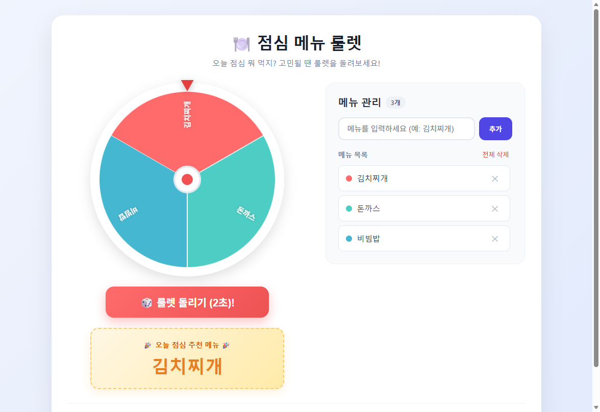
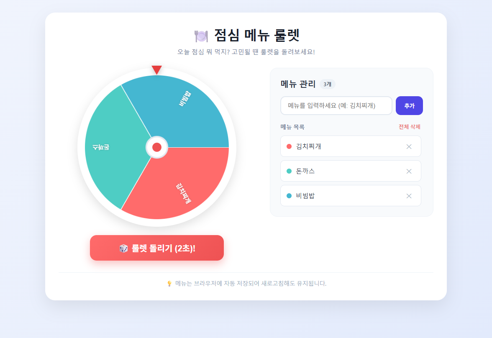

# 🍽️ 점심 메뉴 룰렛 (Lunch Menu Roulette / 午餐菜单轮盘)

오늘 점심 메뉴가 고민될 때 돌려보는 가볍고 직관적인 웹 룰렛 애플리케이션입니다.  
별도의 설치나 서버 구동 없이, `index.html` 파일을 더블클릭하는 것만으로 브라우저에서 바로 동작합니다.

---

## 📌 주요 기능

1. **메뉴 추가 및 삭제**
   - 텍스트 입력 후 [추가] 버튼 클릭 또는 `Enter` 키 입력으로 메뉴 등록
   - 빈 값 입력 및 중복 메뉴 입력 방지 유효성 검사
   - 개별 메뉴 삭제(✕) 및 전체 삭제 지원
2. **2초간 룰렛 회전 애니메이션 & 당첨 결과 표시**
   - [룰렛 돌리기] 버튼 클릭 시 정확히 2초간 가속 및 부드러운 감속(`ease-out cubic`) 회전
   - 룰렛이 멈춘 후 선정된 메뉴를 화면 하단에 팝업 카드로 크게 표시
3. **새로고침 유지 (`localStorage`)**
   - 메뉴 목록이 브라우저 로컬 스토리지에 자동 저장되어 페이지를 새로고침하거나 브라우저를 닫았다 열어도 데이터가 그대로 유지됩니다.
4. **순수 웹 기술 (Pure Vanilla Web)**
   - 외부 라이브러리, 프레임워크, 외부 폰트/CDN, 서버, 데이터베이스 의존성 없이 순수 HTML5, CSS3, JavaScript로만 제작

---

## 🚀 실행 방법

1. 저장소를 클론하거나 다운로드합니다:
   ```bash
   git clone https://github.com/WANGSHUYA0616/ossw3.git
   ```
2. `index.html` 파일을 더블클릭하여 웹 브라우저(Chrome, Edge, Safari 등)에서 엽니다.

---

## 📂 파일 구조

```
├── index.html                  # 애플리케이션 구조 및 레이아웃
├── style.css                   # 모던 카드 UI 및 반응형 스타일
├── app.js                      # 캔버스 룰렛 드로잉, 회전 애니메이션 및 로컬스토리지 로직
├── screenshot_spin_result.png  # 검증 1: 룰렛 회전 및 당첨 결과 표시 화면
├── screenshot_after_reload.png # 검증 2: 새로고침 후 메뉴 목록 유지 확인 화면
├── verify.ps1                  # 자동화 브라우저 검증 스크립트
└── README.md                   # 프로젝트 문서
```

---

## 📸 동작 화면

### 1. 룰렛 회전 및 추천 메뉴 당첨 화면


### 2. 새로고침 후 메뉴 목록 유지 확인 화면

